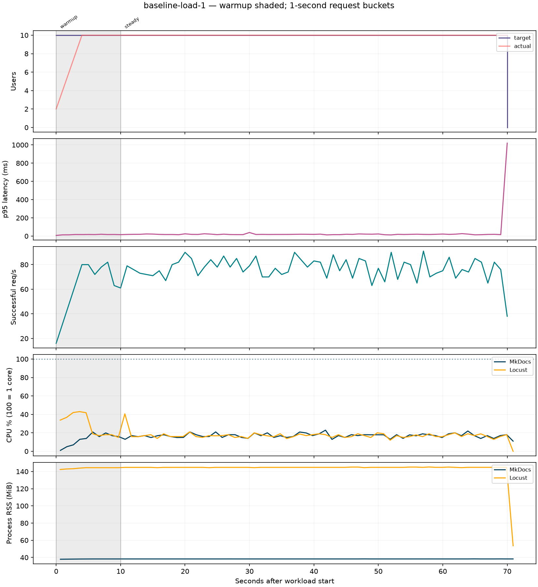
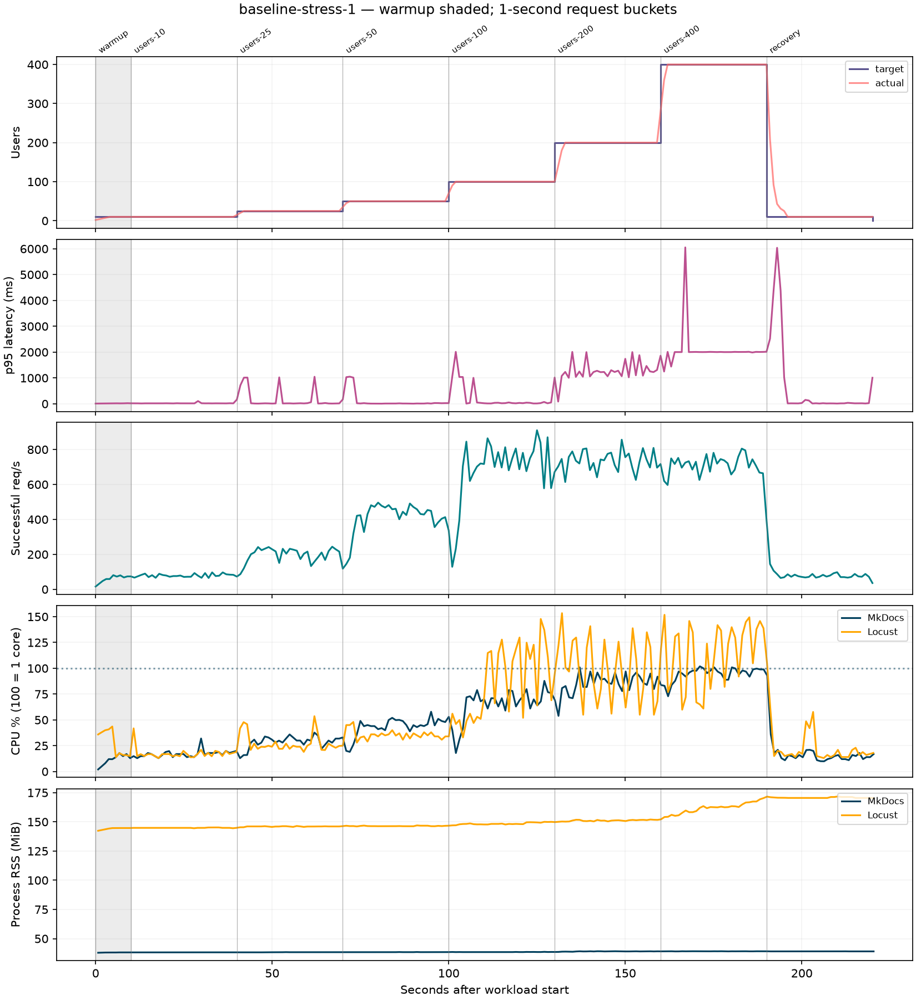
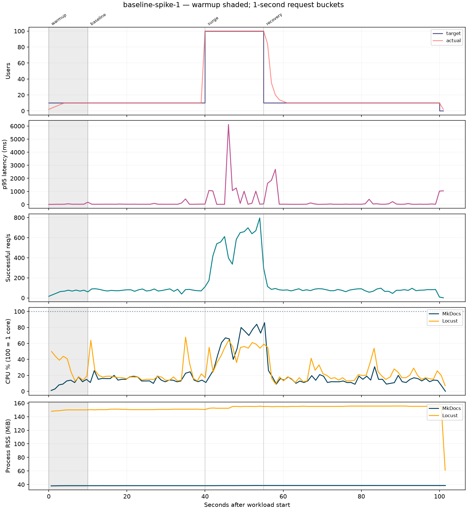

# Performance testing report

Nine full-duration containerized runs tested the MkDocs development HTTP server: three load, three stress, and three spike tests. The campaign ran from **2026-11-24 23:12:08 EST** to **2026-11-24 23:32:49 EST**. Raw request logs contain **323,901 completed requests** including warmup and shutdown drain. Each member owns one randomly assigned test type and its finding.

| Member | Assigned test | Main measured phase | Median successful req/s | Median p95 response (ms) | Median failure rate |
|---|---|---|---:|---:|---:|
| Godson Umoren | Load | steady | 77.33 | 19.80 | 0.000% |
| Hiroto Takeuchi | Stress | users-400 | 711.67 | 2004.89 | 10.196% |
| Ty Carpenter | Spike | surge | 579.80 | 51.19 | 0.424% |

These are measured development-server results under the stated resource limits. Containers make the software environment and resource ceilings consistent; CPU speed, Docker VM scheduling, kernel/network behavior, and shared-host contention still affect absolute timings. CPU quotas are ceilings rather than dedicated reservations. No production-hosting or documentation-build performance claim is made.

## Shared test scope and tools

The system under test is this fork of MkDocs 1.6.1, installed from the checkout into a pinned Python 3.12.12 Linux image. The server command is:

```sh
python -m mkdocs serve --no-livereload -a 0.0.0.0:8000 -f /fixture/mkdocs.yml
```

The fixed offline fixture contains a homepage and 20 Markdown pages, each with 16 sections, plus the default MkDocs theme and search plugin. It is generated and stored inside the image/container filesystem, avoiding host bind-mount overhead in the served files. Startup builds finish before traffic starts. Live-reload polling, document edits/rebuilds, external services, browser JavaScript, and browser rendering are outside this scope.

| HTTP operation | Selection weight | Purpose |
|---|---:|---|
| `GET /` | 3 | Documentation homepage |
| `GET /page-00/` through `/page-19/` | 5 | Documentation navigation; grouped as `document` |
| `GET /css/base.css` | 1 | Small static theme asset |
| `GET /search/search_index.json` | 1 | Larger generated search asset, approximately 463 KiB |

**Locust 2.47.0** generates traffic using `FastHttpUser`, custom `LoadTestShape` profiles, a master plus two worker processes, native CSV statistics, and HTML reports. **psutil 7.2.2** samples CPU, RSS, and thread counts once per second for the MkDocs and generator process trees. **Matplotlib** renders the charts; phase statistics are calculated from raw requests with NumPy linear-interpolated percentiles. Resource sampling supplies the performance findings; no function-level profiler was used. See the [Locust API](https://docs.locust.io/en/stable/api.html), [Locust configuration](https://docs.locust.io/en/stable/configuration.html), and [psutil documentation](https://psutil.readthedocs.io/stable/).

## Environment, controls, and interpretation

| Setting | Recorded value |
|---|---|
| Source commit | `6fa95ce02fd4c0ed359d29daf5fed6fd33ffca1a`; exact source and harness hashes retained in suite manifest |
| Image ID | `sha256:92920a4f3e64cfb5153a077365ca396dd2daa4f17f6e24f43dc1b5ab0d52242d` |
| Docker server / Compose | 29.9.3 / 5.7.1 |
| Container OS / architecture | Linux / aarch64 |
| Docker VM capacity | 8 logical CPUs; 7.75 GiB RAM |
| MkDocs container | 1 CPU, 512 MiB RAM, no swap, 1,024 PID/thread limit |
| Locust container | 2 CPUs, 1 GiB RAM, no swap, 256 PID/thread limit |
| Virtual-user pacing | One outstanding request per user; 0.1 s wait after each request |
| Timeouts and retries | 2 s connect / 5 s network timeout; retries disabled; 5 s shutdown stop timeout |
| Repeats and ordering | Three repeats each; load/stress/spike, stress/spike/load, spike/load/stress |
| Warmup / random seed | 10 s before every profile, excluded from phase tables; seed 777 + repeat |

Docker limits were read back from the app container, and the generator recorded its effective cgroup quotas. Both containers use a private internal Compose network without published host ports. The application is restarted for every run. A [names-redacted container snapshot](results/background-containers.json) recorded only the two benchmark containers running at that instant; it does not characterize other host processes throughout the campaign. The base image is pinned by digest; transitive Python versions, fixture hashes, image ID, and source hashes are retained. This campaign was executed with the new benchmark files uncommitted, as recorded in `source_status`; the application source was unchanged.

The initial single-worker stress attempt raised a Locust CPU-saturation warning, so it was excluded and the generator changed to two workers inside its existing two-CPU budget. The [diagnostic log and resource trace](results/diagnostic-single-worker/README.md) document the reason. The final campaign uses only the two-worker implementation. [Locust documents process-level CPU scaling](https://docs.locust.io/en/stable/running-distributed.html).

CPU 100% means one logical CPU fully occupied; generator capacity is nominally 200%. One-second samples can slightly exceed a ceiling at scheduling boundaries. RSS is sampled process-tree resident memory in MiB, rather than host memory; cgroup memory and throttling counters are also saved. Samplers share container quotas but their own process CPU/RSS are recorded separately and excluded from the application/generator totals. Periodic readiness probes also share the app quota. See [Docker resource constraints](https://docs.docker.com/engine/containers/resource_constraints/).

This is a **closed workload**: user counts do not prescribe a fixed request-arrival rate. Latency and failure rates include all completed responses in the named phase; throughput counts successful completions divided by phase duration. Requests are assigned by completion time, so recovery can include slow requests initiated during the surge. User reductions can cancel in-flight requests after the stop timeout; requests without a completion event are absent from latency/error totals. Warmup and post-profile `drain` requests are preserved separately. CPU averages use samples timestamped within the phase; boundary samples have approximately one second of uncertainty. Native Locust CSV snapshots may precede final drain completions; `locust-final.json` sums native worker counters, including counters already sent to the master, and was checked against the merged raw request counts. The master can miss late worker reports during shutdown; its final snapshot is retained separately as `master-final.json`. Aggregate user counts combine a request worker's exact local count with the other worker's most recent nominal quarter-second sample, so transition counts have sampling uncertainty. The report uses raw-request phase summaries, not rounded native percentile buckets.

Charts retain warmup and shutdown completions. The last request bucket can cover only part of a second; a final throughput drop or latency spike at shutdown is not evidence of a capacity change. The phase tables exclude shutdown drain.

There is no documented production user target or latency SLO for this development server. Ten users is the experimental baseline, and 400 users is the chosen stress ceiling. The bounded pilot validated the harness; its short results are excluded from the full-campaign statistics. Findings identify observed behavior without treating a synthetic threshold as a production service guarantee.

## Load test — Godson Umoren

### Design and configuration

Locust ramps to ten users at two users/s during a ten-second warmup, then holds ten users for 60 measured seconds. All four HTTP operations use the shared weights and pacing. The aim is to establish baseline response time, throughput, and resource usage under sustained low concurrency. Total scheduled duration is 70 seconds per repetition.

### Results

| Run | Measured requests | Failures | Successful req/s | p50 ms | p95 ms | p99 ms | Mean app CPU % | Peak app RSS MiB |
|---|---:|---:|---:|---:|---:|---:|---:|---:|
| baseline-load-1 | 4,640 | 0 | 77.33 | 9.94 | 20.01 | 1035.24 | 17.07 | 38.35 |
| baseline-load-2 | 4,504 | 0 | 75.07 | 8.88 | 19.80 | 1042.44 | 14.51 | 38.35 |
| baseline-load-3 | 4,672 | 1 | 77.85 | 8.93 | 18.74 | 1034.76 | 15.58 | 38.75 |



The representative first run shows target/actual users, one-second p95 latency, successful throughput, CPU, and RSS. Warmup is shaded. [Run 2 chart](results/baseline-load-2/timeseries.png), [run 3 chart](results/baseline-load-3/timeseries.png), and [native Locust report](results/baseline-load-1/locust.html) are also retained.

### Performance finding L1: slow response tail at low concurrency

Across the three measured steady phases, **236 of 13,816 requests (1.71%) took at least one second**. Median run p95 was 19.80 ms, while median run p99 was 1035.24 ms. Mean app CPU had a median of 15.58% of one CPU, and peak RSS across runs was 38.75 MiB. One stylesheet request timed out during the third run's steady phase. The response tail exists even at the low-concurrency baseline; aggregate CPU/RSS do not establish its cause. Connection acceptance and scheduling would need further investigation to explain it.

## Stress test — Hiroto Takeuchi

### Design and configuration

After ten seconds of warmup, Locust steps through 10, 25, 50, 100, 200, and 400 users, with 30 seconds allocated to each stage. Spawn rates are 10, 5, 10, 20, 40, and 80 users/s respectively. Each higher stage includes approximately three to five seconds of ramping before holding its target. A final 30-second recovery phase returns to ten users. Total scheduled duration is 220 seconds per repetition. The user ceiling, container CPU/RAM/PID limits, request timeouts, and wall-clock bound keep the workload finite.

### Results

The following values are the **median of the three per-run phase statistics**; peak RSS is the maximum across repetitions. They are not percentiles pooled across different user levels.

| Target users / phase | Successful req/s | p50 ms | p95 ms | p99 ms | Failure % | Mean app CPU % | Peak app RSS MiB |
|---|---:|---:|---:|---:|---:|---:|---:|
| users-10 | 75.93 | 9.03 | 19.45 | 1034.08 | 0.000 | 14.66 | 38.68 |
| users-25 | 193.83 | 4.31 | 16.97 | 1037.33 | 0.000 | 27.74 | 38.88 |
| users-50 | 405.67 | 3.01 | 12.83 | 1018.77 | 0.000 | 42.84 | 38.91 |
| users-100 | 675.67 | 4.21 | 35.46 | 1233.44 | 0.171 | 64.61 | 39.10 |
| users-200 | 718.40 | 8.27 | 1235.58 | 2005.59 | 2.594 | 85.19 | 39.57 |
| users-400 | 711.67 | 13.70 | 2004.89 | 4374.02 | 10.196 | 94.31 | 39.68 |
| recovery | 94.53 | 10.78 | 2003.61 | 4389.35 | 5.679 | 19.67 | 39.59 |



[Run 2 chart](results/baseline-stress-2/timeseries.png), [run 3 chart](results/baseline-stress-3/timeseries.png), [native Locust report](results/baseline-stress-1/locust.html), and [all individual phase results](results/baseline-summary.md) provide the unaggregated evidence.

### Performance finding S1: higher concurrency increases delays and errors without proportional throughput

Doubling the target from 200 to 400 users changed median successful throughput from **718.40 to 711.67 req/s (-0.9%)**, while median p95 changed from 1235.58 to 2004.89 ms. At 400 users the median failure rate was 10.196%, median mean app CPU was 94.31%, and the highest sampled app RSS was 39.68 MiB. This is an observed capacity limit for this workload/configuration; increasing users does not scale useful throughput proportionally.

The generator peaked at 193.10% aggregate CPU during the 400-user phases against its 200% nominal allowance; the busiest individual process peaked at 97.30% against a single-core ceiling near 100%. Mean generator CPU across those phases ranged from 107.48% to 113.89%. One of the 90 one-second samples had an individual process at or above 90%; no Locust CPU-saturation warning was emitted in the final campaign. Sustained generator saturation was not observed, but brief generator contention could affect peak-load measurements. Low app RSS relative to the 512 MiB limit means memory exhaustion was not the observed limiting symptom. Request error details and cgroup throttling remain available in the raw files; an exact function-level or kernel-level cause was not established.

## Spike test — Ty Carpenter

### Design and configuration

After ten seconds of warmup, Locust holds ten users for 30 seconds, jumps to 100 users for 15 seconds at a 400-users/s spawn rate, then returns to ten users for 45 seconds. The spike is a tenfold sudden increase, rather than a sequence of gradual stress stages. Total scheduled duration is 100 seconds per repetition. Actual observed users are saved so that target changes are not mistaken for immediate completion of all outstanding requests.

### Results

| Phase | Target users | Median successful req/s | Median p95 ms | Median failure % | Median mean app CPU % | Peak app RSS MiB |
|---|---:|---:|---:|---:|---:|---:|
| baseline | 10 | 78.60 | 19.89 | 0.000 | 16.15 | 38.28 |
| surge | 100 | 579.80 | 51.19 | 0.424 | 59.27 | 38.64 |
| recovery | 10 | 82.96 | 32.72 | 0.054 | 16.18 | 38.90 |



[Run 2 chart](results/baseline-spike-2/timeseries.png), [run 3 chart](results/baseline-spike-3/timeseries.png), and [native Locust report](results/baseline-spike-1/locust.html) show repeatability and the recovery transition.

### Performance finding P1: surge behavior and recovery

The tenfold increase changed median phase p95 from **19.89 ms to 51.19 ms** and successful throughput from 78.60 to 579.80 req/s. The median surge failure rate was 0.424%. This distinguishes the transient response to a sudden jump from the gradual stress test.

Recovery-phase totals include outstanding surge requests. To assess the settled state separately, the last 20 seconds of each recovery phase were calculated directly from the raw request timestamps:

| Run | Successful req/s, final 20 s | p95 ms, final 20 s | Failures, final 20 s | Observed users min–max |
|---|---:|---:|---:|---|
| baseline-spike-1 | 76.40 | 44.98 | 0 | 10–10 |
| baseline-spike-2 | 77.85 | 20.20 | 0 | 10–10 |
| baseline-spike-3 | 78.55 | 19.05 | 0 | 10–10 |

These windows are a subset of recovery, not additional requests to add to its totals. They show whether performance returned toward its pre-spike baseline after pending work cleared. The results support only recovery over this observation window; they are not a long-duration memory-leak or resilience test. The extra calculations and error counts are retained in [supplementary metrics](results/baseline-supplementary.json).

Recorded campaign failures included 9,536 timeout errors across completed requests. Exact messages, affected endpoints, and phase-specific counts are available in the raw request logs and supplementary metrics.

## Group contributions and assignment

The fork history identifies `Hiro`/`Hiroto Takeuchi`, `Godson Umoren`, and `tjc7058`; the [project roster](../project-proposal.md) maps the latter to Ty Carpenter. A one-time `SystemRandom` shuffle assigned the three test types. The persisted [assignment record](assignments.json) is the authority for ownership and is not changed on reruns.

| Member | Assigned test responsibility | Performance finding |
|---|---|---|
| Godson Umoren | Load profile, baseline results, and load report section | L1: slow response tail at low concurrency |
| Hiroto Takeuchi | Stress stages, capacity results, and stress report section | S1: diminishing throughput and increasing delays/errors |
| Ty Carpenter | Spike/recovery profile, transient results, and spike report section | P1: response to a tenfold surge and subsequent recovery |

All measurements and evidence were collected through the shared automated harness in this checkout. The table assigns each member responsibility for one test type, its finding, and its report section.

## Evidence and reproduction

See the [README](README.md) for exact setup, execution, analysis, single-profile, pilot, and cleanup commands. Source lives in [`courseProjectCode/performance-testing/`](../../courseProjectCode/performance-testing/). Each run includes raw compressed request measurements, native Locust reports, application/generator resource traces, logs, fixture hashes, dependency versions, timing, effective limits, and a derived summary/chart.

- [Campaign provenance](results/baseline-suite.json) records the source, image, Docker capacity, hashes, and completed runs.
- [All phase results](results/baseline-summary.md) retain each run rather than only aggregate values.
- [Machine-readable phase/endpoint summaries](results/baseline-summary.json) allow independent inspection.
- [Pilot results](results/pilot-summary.md) document harness validation and are excluded from the full-run conclusions.

Validation checked all nine scheduled runs, all four endpoint categories, raw request totals against final native worker counters, expected user targets, phase/resource coverage, and absence of Locust user-code exceptions. Failures caused by the measured workload were kept as findings rather than discarded. All benchmark containers were stopped after execution.
